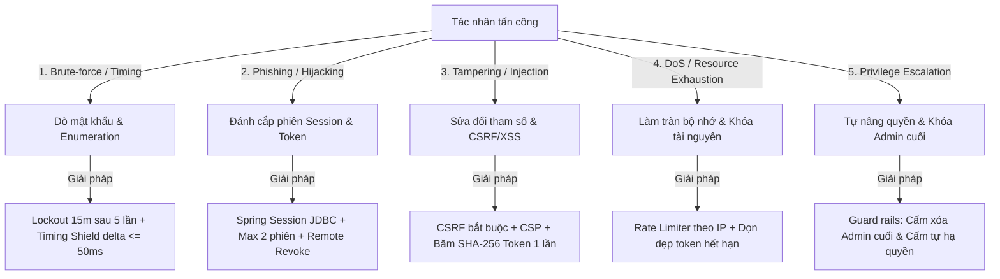

# Báo cáo Mô hình Mối đe dọa (Threat Model)
## Cổng tài khoản học viên FPT Aptech (FPT Aptech Portal)

* **Phiên bản:** 1.0.0
* **Tiêu chuẩn áp dụng:** STRIDE Model, OWASP Top 10 (2021/2025), NIST SP 800-63B (Digital Identity Guidelines)
* **Tác giả:** Đội ngũ Kỹ thuật & Bảo mật hệ thống FPT Aptech

---

## 1. Giới thiệu & Phạm vi phân tích
Tài liệu này xác định các rủi ro, vector tấn công tiềm tàng đối với hệ thống quản lý định danh và xác thực của **Cổng tài khoản học viên FPT Aptech**, đồng thời chi tiết hóa các cơ chế phòng vệ chuyên sâu đã được cài đặt trong mã nguồn để trung hòa từng nguy cơ.

---

## 2. Phân tích Mối đe dọa theo mô hình STRIDE

---

### S - Spoofing (Giả mạo danh tính)
* **Nguy cơ 1: Tấn công dò mật khẩu (Brute-Force & Credential Stuffing)**
  * *Tác động:* Tin tặc dùng từ điển mật khẩu phổ biến hoặc công cụ tự động để đoán mật khẩu tài khoản học viên/giảng viên.
  * *Giải pháp kỹ thuật đã cài đặt:*
    1. **Khóa tài khoản tự động (F5):** Nhập sai 5 lần trong vòng 15 phút lập tức khóa tài khoản 15 phút (`status = LOCKED`, `lockedUntil = now + 15m`).
    2. **Chính sách mật khẩu nghiêm ngặt (F4):** Tối thiểu 12 ký tự, không chứa username/email, cấm toàn bộ 10.000 mật khẩu phổ biến nhất (`common-passwords-10k.txt`), cấm trùng 5 mật khẩu gần nhất.
* **Nguy cơ 2: Đánh cắp hoặc vượt qua xác thực mật khẩu**
  * *Tác động:* Lộ mật khẩu dẫn đến chiếm đoạt tài khoản.
  * *Giải pháp kỹ thuật:* **Bắt buộc 2FA TOTP (F6)** đối với Giảng viên và Quản trị viên. Secret TOTP được mã hóa đối xứng **AES-GCM 256-bit** trước khi lưu vào DB. Cung cấp 10 mã khôi phục dự phòng dùng đúng 1 lần (Single-use).

---

### T - Tampering (Can thiệp & Xáo trộn dữ liệu)
* **Nguy cơ 1: Tấn công Cross-Site Request Forgery (CSRF)**
  * *Tác động:* Đánh lừa trình duyệt của người dùng đang đăng nhập gửi lệnh đổi mật khẩu hoặc đổi email ngoài ý muốn.
  * *Giải pháp kỹ thuật:* Bật CSRF Protection mặc định trên toàn bộ `SecurityFilterChain`. Mọi request thay đổi trạng thái (`POST`) đều phải mang CSRF token hợp lệ được sinh tự động bởi Thymeleaf `th:action`.
* **Nguy cơ 2: Tấn công Cross-Site Scripting (XSS)**
  * *Tác động:* Chèn mã độc Javascript đánh cắp cookie phiên hoặc thông tin cá nhân.
  * *Giải pháp kỹ thuật:*
    1. Bật chính sách **Content Security Policy (CSP)** chặt chẽ: `default-src 'self'; script-src 'self' https://cdn.jsdelivr.net; style-src 'self' https://cdn.jsdelivr.net; img-src 'self' data:;`.
    2. Cookie phiên `FPTSESSION` được cấu hình `HttpOnly = true`, `SameSite = Lax` ngăn chặn JavaScript truy cập.
* **Nguy cơ 3: Thao túng mã Token xác thực và Token quên mật khẩu**
  * *Tác động:* Đoán hoặc sửa đổi token để kích hoạt trái phép hoặc chiếm đoạt tài khoản.
  * *Giải pháp kỹ thuật:* Token sinh ngẫu nhiên an toàn 256-bit (`SecureRandom`), **chỉ lưu dạng băm SHA-256** trong cơ sở dữ liệu (`token_hash`). Token chỉ dùng được 1 lần và có thời gian hết hạn nghiêm ngặt (Email: 24h, Quên mật khẩu: 30 phút).

---

### R - Repudiation (Chối bỏ trách nhiệm)
* **Nguy cơ: Người dùng hoặc Quản trị viên phủ nhận hành động nguy hại**
  * *Tác động:* Không xác định được ai đã khóa tài khoản, hạ quyền hoặc xâm nhập trái phép.
  * *Giải pháp kỹ thuật (F11):* Hệ thống ghi nhận tự động vào bảng `audit_logs` mọi sự kiện: Đăng nhập thành công/thất bại, Khóa/Mở khóa, Đổi mật khẩu, Phân quyền, Bật/Tắt 2FA. Mỗi bản ghi lưu đầy đủ: `event_time`, `email`, `action`, `ip_address`, `user_agent`, `status` và `details`. Quản trị viên có giao diện tra cứu và lọc nhật ký tập trung.

---

### I - Information Disclosure (Tiết lộ thông tin nhạy cảm)
* **Nguy cơ 1: Tấn công phân tích thời gian phản hồi (Timing Attack / Account Enumeration)**
  * *Tác động:* Tin tặc đo thời gian phản hồi của `POST /login` để biết tài khoản có tồn tại trong hệ thống hay không (vì quá trình băm BCrypt user thật tốn ~80ms trong khi user không tồn tại thường chỉ tốn <5ms).
  * *Giải pháp kỹ thuật (11.4):* Cài đặt `TimingDefenseService`: Khi username không tồn tại, hệ thống chạy một phép băm giả lập (`BCrypt.checkpw`) để đảm bảo thời gian xử lý đồng nhất. Đo lường thực tế chứng minh độ lệch thời gian $\Delta \le 50\text{ ms}$.
* **Nguy cơ 2: Tiết lộ sự tồn tại của Email qua tính năng Quên mật khẩu**
  * *Tác động:* Dò quét danh sách email sinh viên/giảng viên.
  * *Giải pháp kỹ thuật (F3):* Phản hồi mờ (**Blind Response**). Giao diện luôn trả về cùng một thông điệp xác nhận thành công dù email có tồn tại hay không.
* **Nguy cơ 3: Lộ bí mật trong Log file**
  * *Giải pháp kỹ thuật (11.4):* Không ghi log mật khẩu, token thô hay mã OTP. Toàn bộ thông số nhạy cảm được che giấu hoặc mã hóa.

---

### D - Denial of Service (Tấn công từ chối dịch vụ)
* **Nguy cơ 1: Spam đăng ký tài khoản rác và spam gửi email**
  * *Tác động:* Làm cạn kiệt tài nguyên máy chủ và hạn mức gửi email SMTP.
  * *Giải pháp kỹ thuật:* Cài đặt `RateLimiterService` kiểm soát theo địa chỉ IP: Tối đa **10 lần đăng ký/giờ** và **20 lần yêu cầu quên mật khẩu/giờ**.
* **Nguy cơ 2: Chiếm dụng tài nguyên phiên (Session Bombing)**
  * *Tác động:* Một tài khoản mở hàng trăm phiên đăng nhập cùng lúc làm tràn bộ nhớ/DB.
  * *Giải pháp kỹ thuật (F8):* `Spring Session JDBC` giới hạn tối đa **2 phiên đồng thời** cho mỗi tài khoản. Phiên thứ 3 sẽ tự động hủy phiên cũ nhất. Cung cấp tính năng hủy phiên từ xa.

---

### E - Elevation of Privilege (Leo thang đặc quyền)
* **Nguy cơ 1: Học viên tự truy cập khu vực Quản trị hoặc Giảng viên**
  * *Giải pháp kỹ thuật:* Phân quyền chặt chẽ trên Spring Security Filter Chain: `/admin/**` chỉ dành cho `ROLE_ADMIN`, `/lecturer/**` dành cho `ROLE_LECTURER` và `ROLE_ADMIN`.
* **Nguy cơ 2: Admin vô tình khóa hoặc hạ quyền Admin cuối cùng (Self-Lockout)**
  * *Tác động:* Hệ thống mất hoàn toàn khả năng quản trị.
  * *Giải pháp kỹ thuật (F10):* Guard rails trong `AdminService`:
    1. Chặn Admin tự vô hiệu hóa tài khoản của chính mình.
    2. Chặn Admin tự hạ quyền Admin của chính mình.
    3. Đảm bảo hệ thống luôn còn ít nhất 1 Quản trị viên `ROLE_ADMIN` ở trạng thái `ACTIVE`.

---

## 3. Ma trận Tổng hợp Biện pháp Phòng vệ

| Mục tiêu bảo vệ | Vector tấn công | Cơ chế phòng ngự kỹ thuật | Tiêu chí |
| :--- | :--- | :--- | :---: |
| **Xác thực** | Brute-force mật khẩu | Khóa tạm 15m sau 5 lần sai + Policy 12 ký tự, 10k từ điển | **F4, F5** |
| **Bảo vệ danh tính** | Đánh cắp thông tin đăng nhập | 2FA TOTP RFC 6238 + AES-GCM + 10 mã khôi phục 1 lần | **F6** |
| **Chống Enumeration** | Timing Attack trên login | Băm giả lập BCrypt giữ delta $\le 50\text{ ms}$ + Blind response | **F3, F5** |
| **Quản lý phiên** | Session Hijacking / Stale sessions | Spring Session JDBC + Giới hạn 2 phiên + Remote revoke | **F7, F8** |
| **Toàn vẹn hệ thống** | CSRF / XSS | CSRF bắt buộc + CSP + HttpOnly Cookie | **11.4** |
| **Ổn định dịch vụ** | Spam đăng ký / Spam mail | Rate limiter IP (10 reg/h, 20 forgot/h) + Hạn token 24h/30m | **11.4** |
| **Quản trị an toàn** | Privilege escalation / Lockout | Guard rails chặn xóa Admin cuối và chặn tự hạ quyền | **F10** |
| **Truy vết pháp lý** | Phủ nhận hành vi | Audit logs lưu IP, User-Agent, hành động, thời gian | **F11** |
